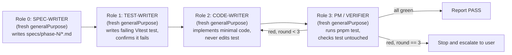

# TDD Pipeline (Role-Separated Test-Driven Development)

## Why role separation, not just discipline

Plain TDD asks one agent to write a failing test, watch it fail, then write minimal
code to pass it. That works, but it depends entirely on the same context staying
honest with itself across all steps. The single most common way AI coding
agents break TDD is by quietly weakening the test instead of fixing the
implementation -- deleting an inconvenient assertion, loosening a comparison, or
mocking away the exact behavior that was supposed to be checked. An agent that
wrote both the test and the code has every incentive (and the context) to do this
without even framing it as cheating to itself.

Splitting the work across isolated subagents closes that loophole structurally
instead of relying on willpower:

- The **spec-writer** turns the phase requirements into concrete, unit-testable
  specs (`specs/phase-N/*.md`), splitting multiple behaviors into sub-specs.
- The **test-writer** never sees an implementation, so it can't tailor the test to
  one.
- The **code-writer** never sees the test-writer's reasoning or private notes,
  only the test file itself and the original spec -- so its only path to "done" is
  making the real test pass, not negotiating with itself about what the test
  "really meant."
- The **PM/verifier** is a fresh agent with no investment in either the test or
  the code, so its pass/fail report isn't colored by having just written the thing
  it's checking.

In Cursor, invoke the `Task` tool with `subagent_type: "generalPurpose"` for
every role below -- **never `resume` a previous subagent**, since each role must
start with a clean context.

## Before spawning anything

1. **Produce or load the spec(s).** For each phase (from Phase 2 onward), first
   spawn a fresh **spec-writer** subagent instructed to follow
   `.cursor/skills/spec-writer/SKILL.md`. If it returns questions for the user,
   ask them via `AskQuestion` and respawn the spec-writer with the answers until
   `specs/phase-N/*.md` is written.
2. **Test commands in this repo:**
   - Single test file: `pnpm test <path/to/file.test.js>`
   - Full suite: `pnpm test`
   - Never run or write Playwright / e2e tests (`No automatic e2e` rule).
3. **Run one pipeline per sub-spec.** If a phase has multiple sub-specs (e.g.
   `specs/phase-3/query-engine.md` and `specs/phase-3/facet-counts.md`), run
   Test-writer -> Code-writer -> PM for each sub-spec in turn.

## The pipeline

### Role 0: Spec-writer

Spawn a fresh `generalPurpose` Task subagent.

Prompt it with:

- Instruction to read `.cursor/skills/spec-writer/SKILL.md` first.
- The current phase goal, relevant details from the plan, and existing file
  paths/types it should reference.
- Instruction to return consolidated clarifying questions if anything blocking or
  edge-case-critical is unresolved, or otherwise write `specs/phase-N/<slug>.md`
  (splitting into multiple sub-specs when the phase has multiple distinct
  behaviors).

### Role 1: Test-writer

Spawn a fresh `generalPurpose` Task subagent. It must **not** write or even
sketch implementation code -- only the test file(s).

Prompt it with, at minimum:

- The exact spec file path and its full contents.
- The test framework (Vitest + Testing Library), file location convention
  (`src/**/*.test.js`), and command to run a single test file
  (`pnpm test <path>`).
- Instruction to write one or more minimal, real-behavior tests (no testing
  mocks unless a dependency makes that unavoidable) that will fail until the
  feature exists.
- Instruction to **run the test itself** and confirm it fails for the right
  reason -- missing module/behavior, not a syntax typo in the test or broken
  test setup -- and to fix the test and re-run if the test itself has a syntax
  error.
- Instruction to report back: the test file path(s), the exact failing output,
  and a one-line explanation of why it fails.

Do not proceed until you have that failing-output evidence in hand. A test-writer
that reports success without ever running the test hasn't done the job --
send it back to actually run it.

### Role 2: Code-writer

Spawn a **new** fresh `generalPurpose` Task subagent -- don't reuse the
test-writer's agent, and don't let it see the test-writer's scratch reasoning,
only the artifact (the test file) and the spec.

Prompt it with:

- The original spec file path and full contents.
- The exact path and full contents of the failing test file(s), plus the
  failure output the test-writer captured.
- An explicit instruction **not to edit the test file(s)**. If it believes a test
  is wrong, it must say so in its report instead of changing it.
- Instruction to write the minimal code that makes the test(s) pass -- no
  speculative options, config flags, or unrelated refactors.
- Instruction to report back a summary of the files it created or changed.

On retry rounds (see below), also give it the PM's failure report from the
previous round instead of having it guess what's still wrong.

### Role 3: PM / verifier

Spawn another fresh `generalPurpose` Task subagent. Its only job is to run
things and report facts -- it doesn't need to judge design quality.

Prompt it with:

- The exact command to run the **full** test suite: `pnpm test` (not just the
  new test file -- a regression elsewhere is still a failure).
- The path(s) to the test file(s) the test-writer created and the expected
  assertions from Role 1.
- Instruction to run `pnpm test`, then report verbatim: which test files and
  tests passed, which failed, and the exact failure output for any that failed.
- Instruction to inspect the test file(s) and flag plainly if any test was
  edited, weakened, or deleted by the code-writer.

The PM's report is authoritative. Don't let a code-writer's "I believe this
passes now" substitute for the PM actually running it.

## The fix loop

If the PM reports failures, start a new round: spawn a **new** code-writer
subagent (fresh instance, not a continuation) with the spec, the test file, and
the PM's exact failure report from this round. Then spawn a new PM to re-verify.

Cap this at **3 rounds total**. If round 3's PM still reports failures, stop --
don't spawn a round 4. Report to the user: the spec, the test file, all three
rounds' PM reports, and your own assessment of whether the test or the approach
looks like the actual problem.

## After a PASS

Summarize the run for the user: what was built, the spec and test file path(s),
how many rounds it took, the final PM verdict, what to inspect in the browser,
and end with the single-line plain-English commit message required by the
`git-and-tdd` rule.

## Common failure modes to watch for as orchestrator

| Symptom                                                                                  | What's actually happening                                                                                                                           |
| ---------------------------------------------------------------------------------------- | --------------------------------------------------------------------------------------------------------------------------------------------------- |
| Test-writer reports a failing test but never shows you run output                        | It didn't actually run it. Send it back.                                                                                                            |
| Code-writer's changes touch the test file                                                | It was told not to. Reject the round, restore the test file from Role 1, respawn code-writer and remind it of the constraint.                       |
| PM's report is vague ("looks good") instead of exact test names/output                   | PM didn't actually run the suite, or is summarizing instead of reporting. Send it back for verbatim output.                                         |
| Same failure repeats verbatim across rounds                                              | Code-writer isn't receiving the previous PM report properly, or the test itself may be wrong -- pause to check before burning the remaining rounds. |
| You're tempted to skip spawning a real PM and just eyeball the code-writer's self-report | Don't. That collapses the whole point of this pattern back into single-agent TDD.                                                                   |
